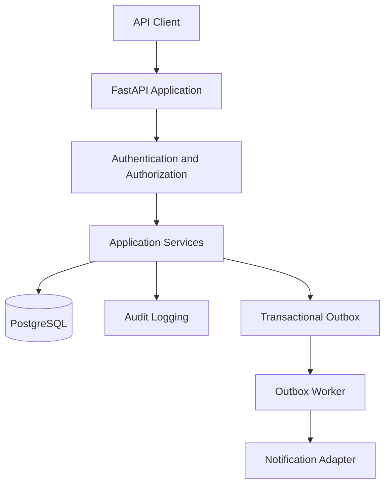

# EnterpriseFlow

**A multi-tenant enterprise workflow and approval API built with Python, FastAPI, and PostgreSQL.**

EnterpriseFlow provides a backend for managing organizational approval workflows, enforcing role-based access control, maintaining audit trails, and reliably dispatching events through a transactional outbox.

## Key Features

- **Authentication and authorization** — JWT-based authentication and role-based access control.
- **Multi-tenant isolation** — organization-scoped users and workflow data, with organization context derived from the authenticated user.
- **Approval workflows** — manage workflow requests through draft, pending, approved, and rejected states.
- **Audit logging** — record workflow actions and status transitions with append-only database enforcement.
- **Transactional outbox** — persist events alongside application changes, claim work safely, and retry failed deliveries.
- **Reliable event processing** — use PostgreSQL row locking, claim tokens, retry limits, and stale-claim protection.
- **Pagination and reporting** — support paginated workflow retrieval.
- **Health and readiness checks** — distinguish application liveness from database connectivity.
- **Automated testing and CI** — pytest, Ruff, and GitHub Actions.
- **Containerized deployment** — run the API and PostgreSQL using Docker Compose.

## Technology Stack

| Area | Technologies |
|---|---|
| Language | Python 3.13 |
| API | FastAPI, Uvicorn |
| Validation and configuration | Pydantic, Pydantic Settings |
| Database | PostgreSQL 16 |
| Data access | SQLAlchemy async ORM, asyncpg |
| Schema migrations | Alembic |
| Authentication | JWT, password hashing with Argon2 support |
| Testing | pytest, pytest-asyncio, HTTPX |
| Code quality | Ruff |
| Deployment | Docker, Docker Compose |
| CI | GitHub Actions |

## Architecture



The API uses a modular structure that separates HTTP routes, validation schemas, application services, database models, and shared dependencies.

The transactional outbox stores events in PostgreSQL so that event records can participate in the same database transaction as the business operation. A separate worker processes queued events and applies retry and claim-handling rules.

The current notification adapter logs notification events; integration with an external notification provider can be added behind the notifier interface.

## Project Structure

```text
enterpriseflow/
├── app/
│   ├── api/
│   │   ├── dependencies.py
│   │   └── v1/routes/
│   ├── core/
│   │   ├── config.py
│   │   └── security.py
│   ├── db/
│   ├── models/
│   ├── schemas/
│   ├── services/
│   ├── workers/
│   └── main.py
├── migrations/
├── scripts/
├── tests/
├── .github/workflows/
├── Dockerfile
├── docker-compose.yml
└── pyproject.toml
```

## Getting Started

### Prerequisites

- Python 3.13+
- PostgreSQL 16, or Docker with Docker Compose
- Git

### Option 1: Run Locally

Clone the repository:

```bash
git clone https://github.com/kalyanvsm/enterpriseflow.git
cd enterpriseflow
```

Create and activate a virtual environment:

```bash
python3 -m venv .venv
source .venv/bin/activate
```

Install the project and development dependencies:

```bash
python -m pip install .
python -m pip install --group dev
```

Configure the required environment variables using your local environment or an ignored `.env` file. The settings include:

- `POSTGRES_HOST`
- `POSTGRES_PORT`
- `POSTGRES_DB`
- `POSTGRES_TEST_DB`
- `POSTGRES_USER`
- `POSTGRES_PASSWORD`
- `JWT_SECRET_KEY`

For local execution, configure the application database to point to your local PostgreSQL instance and keep the test database named `enterpriseflow_test`.

Ensure the application database schema has been initialized using the project's migration process before exercising database-backed endpoints. Do not run migrations against a database until you have confirmed the target.

Start the development server:

```bash
uvicorn app.main:app --reload
```

### Option 2: Run with Docker Compose

Create a local `.env` file containing the required `POSTGRES_PASSWORD` and `JWT_SECRET_KEY` values. Use strong, private values; do not commit this file.

Build and start the services:

```bash
docker compose up --build -d
```

Check service status:

```bash
docker compose ps
```

View API logs:

```bash
docker compose logs --tail=100 api
```

The API is published on `127.0.0.1:8000`, and PostgreSQL is published on `127.0.0.1:5432`.

Stop the services without deleting the database volume:

```bash
docker compose down
```

**Database safety:** the Compose setup does not automatically run Alembic migrations. Confirm the target database and migration state before applying schema changes.

## API Documentation

When the application is running, explore the interactive API documentation:

- Swagger UI: [http://127.0.0.1:8000/docs](http://127.0.0.1:8000/docs)
- OpenAPI schema: [http://127.0.0.1:8000/openapi.json](http://127.0.0.1:8000/openapi.json)

### Health Endpoints

| Method | Endpoint | Purpose |
|---|---|---|
| GET | `/api/v1/health` | Confirms the application process responds |
| GET | `/api/v1/ready` | Checks application readiness and database connectivity |

Example:

```bash
curl -i http://127.0.0.1:8000/api/v1/health
curl -i http://127.0.0.1:8000/api/v1/ready
```

Both endpoints should return HTTP 200 when the application and its database connection are healthy.

## Testing and Code Quality

Run the automated test suite against the dedicated test database:

```bash
pytest -q
```

Run lint checks:

```bash
ruff check .
```

Verify formatting:

```bash
ruff format --check .
```

The tests use a dedicated `enterpriseflow_test` database. Keep it separate from the application database.

## Continuous Integration

GitHub Actions runs the following checks on pushes to `main` and pull requests targeting `main`:

1. Starts a PostgreSQL 16 service for tests.
2. Installs the application and development dependencies.
3. Runs Ruff lint checks.
4. Verifies code formatting.
5. Runs the automated tests.

The workflow uses a dedicated test database and CI-only credentials.

## Engineering Highlights

- Organization-scoped data access and role-based endpoint authorization.
- Database-enforced referential integrity and append-only audit logs.
- Transactional outbox processing with safe concurrent claiming and retry handling.
- Explicit database readiness checks for container orchestration.
- Isolated automated tests and continuous integration.
- Reproducible application packaging with Docker.

## Future Improvements

- Integrate a real notification provider with delivery-level idempotency.
- Add further deployment automation and observability.
- Expand integration and migration testing.
- Add load testing and performance benchmarks.

## License

No license has been specified yet. Add a license before distributing the project for reuse.
